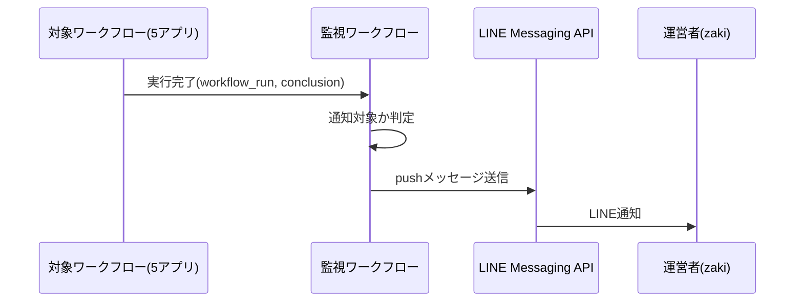

# 設計: digest-failure-notification

## サマリ

- 5アプリの記事生成ワークフローを1つの共通監視ワークフローが`workflow_run`で監視し、失敗時にLINEでpushする**🟡〔提案〕**
- 主要図: [通知のシーケンス図](#失敗を検知して通知する処理)**🟡〔提案〕**

## 決定事項

| 論点 | 選んだ案 | 採らなかった案 | 理由 | 影響範囲 | 出所 |
|---|---|---|---|---|---|
| 監視方式 | 新規の共通ワークフロー1枚が`workflow_run`で5ワークフローを監視 | 各ワークフローに個別実装を追加 | 要件[2]が個別実装を禁止 | 処理フロー・関連するファイル | 〔合意〕 |
| 「最後の再実行」の判定方法 | 監視ワークフローが失敗イベントの発生時刻をcron時刻表と照合(許容誤差±90分) | 最後の再実行かどうかを示す出力を追加する案 | `workflow_run`イベントは元のcron式を含まず、完了済み実行のステップ出力も外部取得できないため時刻照合以外に手段がない | 処理フロー・エラーハンドリング | **🟡〔提案〕** |

<details><summary>詳細を開く</summary>

| 論点 | 選んだ案 | 採らなかった案 | 理由 | 影響範囲 | 出所 |
|---|---|---|---|---|---|
| 通知ロジックの実装言語 | TypeScript(純粋関数+CLI)、vitestでテスト | ワークフローYAML内で直接判定 | 時刻照合・グループ分けの分岐をCIで決定的に検証したい | 関連するファイル | **🟡〔提案〕** |
| コードの配置 | `app/lib/digestFailureNotification/`・`scripts/digest-failure-notification/` | `app/digest-failure-notification/lib/`(アプリ扱い) | CLAUDE.mdの「サイト全体に関わるものは`app/`直下」規約に従う(5アプリ共通の監視のため特定アプリの配下ではない) | 関連するファイル | **🟡〔提案〕** |
| 仕様書フォルダの配置 | `specs/digest-failure-notification/`(`specs/`直下) | `specs/<いずれか1アプリ名>/digest-failure-notification/`(通常の階層規約) | 5アプリ共通でどの単一アプリにも属さない運用監視機能であり、CLAUDE.mdの「サイト全体に関わるもの(ルーティング・共通レイアウト・法的ページ)は`specs/`直下」規約に準じる判断とした | フォルダ構成 | **🟡〔提案〕** |

</details>

## 処理フロー

### 失敗を検知して通知する処理



正となる文章: 下の手順

<details><summary>詳細を開く</summary>

対象5ワークフローのいずれかが完了すると、監視ワークフローが`workflow_run`イベントで起動し、失敗かどうか・通知すべきかどうかを判定する。

- 対象: `workflow_run`イベント(対象5ワークフロー「AI駆動開発ダイジェスト 日次記事公開」「重要ニュース週刊ダイジェスト 週次記事公開」「トレンドダイジェスト 週次記事公開」「研究発見 週次記事公開」「週刊未来予測 週次記事公開」の実行完了)
- 手順:
  1. イベントの`conclusion`が`failure`でない場合(成功・キャンセル等)、何もせず処理を終える
  2. 実行元が自動再実行の仕組みを持たない3ワークフロー(日次・重要ニュース・トレンド)のいずれかの場合、起動要因(`github.event.workflow_run.event`)が`schedule`または`workflow_dispatch`であれば直ちに通知対象と判定する。いずれでもない場合(`workflow_run`。対象ワークフロー自身が持つ`record-ci-failure`ジョブ(CI失敗をPRコメントに記録する補助ジョブ)の失敗であり記事生成の失敗ではないため)は通知せず処理を終える
  3. 実行元が自動再実行の仕組みを持つ2ワークフロー(研究発見・週刊未来予測)のいずれかの場合、後述「再実行完了を判定する処理」に進む
- 関連するビジネスルール: `requirements.md#通知タイミング-1`、`requirements.md#通知タイミング-3`

</details>

### 再実行完了を判定する処理

研究発見・週刊未来予測の失敗が、自動再実行(最大3回)を使い切った最後の回の失敗かどうかを時刻照合で判定する。**🟡〔提案〕**

<details><summary>詳細を開く</summary>

研究発見・週刊未来予測は本番cron失敗後に12時間後・24時間後・36時間後の最大3回まで自動再実行するため、どの回の失敗かを判定する。

- 対象: 研究発見・週刊未来予測の失敗イベント
- 手順:
  1. イベントの起動要因(`github.event.workflow_run.event`)が`workflow_dispatch`の場合、再実行の仕組みの対象外のため直ちに通知対象と判定する
  2. 起動要因が`schedule`の場合、イベントの実行開始時刻(`created_at`、UTC)をJSTに変換し、対象ワークフローの「最後の再実行(本番の36時間後)」の時刻スロット(研究発見2編・週刊未来予測2編の計4通り。各ワークフローのYAML内cronコメントに明記済みの時刻)のいずれかと、許容誤差±90分の範囲で一致するか調べる(GitHub Actionsのscheduled workflowは混雑時に数十分規模で起動が遅延することがあるため、cron時刻の厳密一致ではなく許容誤差を設ける。12時間ごとのスロット間隔に対して十分小さい値とする)
  3. 一致する場合は通知対象と判定し、一致しない場合(本番・12時間後・24時間後の失敗)は通知せず処理を終える
  4. 起動要因が`workflow_dispatch`・`schedule`のいずれでもない場合(`workflow_run`。対象ワークフロー自身が持つ`record-ci-failure`ジョブの失敗であり記事生成の失敗ではないため)は通知せず処理を終える
- 関連するビジネスルール: `requirements.md#通知タイミング-2`、`requirements.md#通知タイミング-3`

</details>

### 通知メッセージを組み立てて送信する処理

通知対象と判定された失敗イベントの情報から通知文を組み立て、LINE Messaging APIでpush送信する。**🟡〔提案〕**

<details><summary>詳細を開く</summary>

- 対象: 通知対象と判定された失敗イベント
- 手順:
  1. ワークフロー名から対応するアプリ名を導出し、アプリ名・失敗したワークフロー名・失敗日時(イベントの`updated_at`をJSTに変換)・該当実行のGitHub Actions上のログへのリンク(`github.event.workflow_run.html_url`)を含むテキストメッセージを組み立てる
  2. LINE Messaging APIのpushメッセージ送信エンドポイント(`POST https://api.line.me/v2/bot/message/push`)へ、`Authorization: Bearer <チャネルアクセストークン>`ヘッダーを付けてリクエストする(実装時に[LINE Developers公式ドキュメント](https://developers.line.biz/ja/reference/messaging-api/#send-push-message)で最新仕様を確認する)。宛先は運営者個人のLINE userId(`LINE_ADMIN_USER_ID`)
  3. レスポンスが成功(HTTPステータス200)の場合、配信成功として実行ログに記録する
  4. レスポンスが失敗の場合、リトライはせず、下記エラーハンドリングに従う
- 関連するビジネスルール: `requirements.md#失敗検知・通知-3`、`requirements.md#失敗検知・通知-4`

</details>

## エラーハンドリング

LINE API呼び出し失敗時はリトライせずステップを失敗させる。失敗が短期間に繰り返しても通知の抑制は行わない(失敗頻度が低い前提のため。頻発するようになった場合は見直す)。**🟡〔提案〕**

<details><summary>詳細を開く</summary>

- LINE push APIがエラーを返した場合(宛先userId不正・無料枠超過・一時的なAPIエラーいずれも)、リトライはせずワークフローのそのステップを失敗として終了する。この通知ワークフロー自体は記事生成・公開の処理に一切関与しないため、通知の失敗が本体の記事生成・公開に影響する経路はない
- 通知自体の失敗を伝える更なる通知手段は設けない(要件のスコープ外「LINE以外の通知チャネルの追加」に合致)。監視ワークフローが失敗表示になることと、GitHubの既定の仕組み(リポジトリの通知設定によりActions失敗時にメールが届く場合がある)が最後の保険となる
- `workflows:`フィルタにより監視ワークフローが受け取る`workflow_run`イベントは対象5ワークフローに限られるが、将来ワークフロー名が変更され想定外の名前が来た場合は、防御的に何もせず処理を終える(通知も送らない)

</details>

## 関連するファイル(抜粋)

新規ワークフロー1枚とTypeScript3ファイル(判定・組み立て・送信)。**🟡〔提案〕**

<details><summary>詳細を開く</summary>

```
.github/workflows/digest-failure-notification.yml (新規: workflow_runで5ワークフローを監視する共通ワークフロー)
app/lib/digestFailureNotification/shouldNotify.ts (新規: conclusion・ワークフロー名・起動要因・発生時刻から通知すべきかを判定する純粋関数)
app/lib/digestFailureNotification/buildNotificationMessage.ts (新規: 通知メッセージ本文を組み立てる純粋関数)
scripts/digest-failure-notification/notify.ts (新規: workflow_runイベントの情報を受け取り判定・LINE送信を行うCLI)
```

</details>

## セキュリティ

通知メッセージにエラー詳細・シークレットは含めず、ワークフロー名・時刻・ログURLのみ載せる。**🟡〔提案〕**

<details><summary>詳細を開く</summary>

- `LINE_CHANNEL_ACCESS_TOKEN`(既存の共通チャネル用。5アプリのLINE記事配信と共有)・`LINE_ADMIN_USER_ID`(新規)はこのリポジトリのActions Secretsとして暗号化保存する
- 通知メッセージの本文には、ワークフロー名・失敗日時・ログへのリンクのみを含め、対象ワークフローのエラーメッセージ・スタックトレースなどの詳細は含めない(詳細なエラー内容をそのままLINE本文に転記すると、万一ログ内にシークレットの断片が混入していた場合に外部へ漏えいする経路になり得るため。詳細を見たい場合はログURLから本体のGitHub Actions実行ログを確認する運用とする)
- このワークフローはGitHubへの書き込み(コミット・PR作成等)を一切行わないため、書き込み用PATは使わない。`workflow_run`イベントの読み取りにはワークフロー既定の`GITHUB_TOKEN`で足りる
- リクエストヘッダー(`Authorization: Bearer <チャネルアクセストークン>`)はいかなる場合もログに出力しない(line-broadcastと同じ方針)

</details>

## ログ

実行元ワークフロー名・判定結果・LINE API呼び出し結果を実行ログに記録する。**🟡〔提案〕**

<details><summary>詳細を開く</summary>

- 実行元ワークフロー名・`conclusion`・通知対象と判定したかどうか(しなかった場合はその理由。例:「再実行未消化のため見送り」)をGitHub Actionsの実行ログに記録する
- LINE API呼び出し結果(成功/失敗)を記録する。失敗した場合はHTTPステータス・エラーレスポンス概要も合わせて記録する
- リクエストヘッダー(`Authorization: Bearer <チャネルアクセストークン>`)はいかなる場合もログに出力しない

</details>
