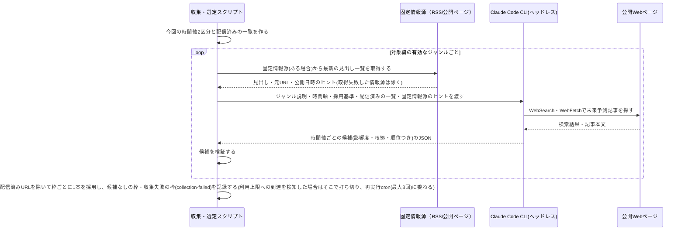

# 設計: ジャンル・時間軸別の未来予測記事の選定

## サマリ
対象編(サイエンス・テクノロジー編/くらし・社会編)のその回の回数から扱う時間軸2区分を決め、対象編の有効なジャンル(5)ごとにClaude Code CLIのヘッドレス実行(WebSearch)で2時間軸分の候補を集めさせ、影響度の判定と順位付けまでを任せる。7ジャンルは収集前に固定情報源(`fixedSources.json`)から最新の見出し一覧を決定的なコードで取得し、プロンプトの手がかり(ヒント)として渡すハイブリッド方式にする(requirements.md#情報源(固定リスト))。採用基準(対象時期・影響度等)の判定自体はヒント付きの候補もWebSearchで見つけた候補も区別せずClaudeが行う(下記「固定情報源からヒントを集める処理」)。編は`genres.json`の各ジャンルの`edition`属性で固定され、動的には切り替わらない(下記「[データ設計](#データ設計ジャンル注目テーマの設定ファイル)」、requirements.md#編成とジャンルの割り当て)。時間軸の基準点となる本来の配信日は、[weekly-publish](../weekly-publish/design.md)が`getScheduledPublishDate`で求めた値を`collect-and-select.ts`のCLI引数として受け取り、本specの内部で実行日時から独自に求めない(requirements.md#時間軸)。配信済みとの重複は、編を問わず全記事を対象に、同じURLを決定的なコードで機械的に除き、実質同じ内容の予測は過去に配信した全予測の見出し・元記事タイトルの一覧をプロンプトに渡してClaudeに判定させる。最後に枠ごとの採用(影響度の最も大きい1本)と、候補が見つからなかった枠・収集の処理自体に失敗した枠(`collection-failed`)の記録を決定的なコードで行い、枠ごとの候補件数を実行ログに出す。利用上限への到達を検知した場合は、その時点で収集を打ち切る(公開はしない。再実行cron(最大3回)での再試行は[weekly-publish/design.md](../weekly-publish/design.md)が扱う)。

主要な設計判断:
- 「記事を探す・時間軸と影響度を判定する・実質的な重複を見分ける」は意味の判断が必要なためClaudeに任せ、「同じURLの除外・枠ごとの採用・候補なしの記録・回数の数え方」は揺れてはいけないため決定的なコードで行う(trend-digestのWebSearchジャンルと同じ役割分担)
- ジャンル・注目テーマ・編の割り当ては`content/future-digest/genres.json`に置き、運営者が追記するだけで増やせる(trend-digestのwatchlist.jsonと同じく、ジャンルごとに`edition`属性を持たせる)
- 回数(`issueNumber`)はその編で公開済みの記事の最大値+1とする。編ごとに独立して数える(利用上限への到達で打ち切られた回は記事ファイルがないため自然に数えない)
- 編の判定は、実行主体(weekly-publishのワークフロー)が起動元のcronから決定し、`collect-and-select.ts`にCLI引数として渡す。本spec自身はどのcronで起動されたかを判定しない(weekly-publish/design.md「編を判定する処理」参照)
- 図: [ジャンルごとに候補を集める処理](#ジャンルごとに候補を集める処理エージェントの推論)のシーケンス図

## 決定事項

| 論点 | 選んだ案 | 採らなかった案 | 理由 | 影響範囲 | 出所 |
|---|---|---|---|---|---|
| 編成の分け方 | ジャンルを`genres.json`の`edition`属性で固定2分割(trend-digestと同じ) | ジャンルを動的に2グループへ振り分ける | 編の判定を固定値にすることで、収集・公開・表示の各処理が「今対象の編はどれか」だけで完結し、揺れが入らない | データ設計・処理フロー全体 | 〔提案〕 |
| 編ごとのジャンル割り当て | サイエンス・テクノロジー編(テクノロジー・AI/医療・健康/環境・エネルギー/宇宙・科学/地政学)とくらし・社会編(経済・働き方/社会・人口・暮らし/性・恋愛/個人的注目分野/その他) | 他の組み合わせ | 科学・技術・国際情勢寄りか、生活・社会寄りかで分けた。唯一の正解はなく承認者の確認が必要 | requirements.md#編成とジャンルの割り当て | 〔提案〕 |
| 配信済み判定の対象範囲 | 編をまたいで全記事を対象に重複除外する | 編ごとに独立して重複除外する | 編が違っても同じ記事・予測を二度配信しないため | 配信済みの一覧を作る処理 | 〔提案〕 |
| `issueNumber`(回数)の数え方 | 編ごとに独立してカウント(その編で公開済みの最大値+1) | 2編共通の通し番号 | 時間軸の交互切り替えは編ごとに完結させたいため。もう一方の編の公開状況に影響されない | その回の時間軸2区分を決める処理 | 〔提案〕 |
| 固定情報源の扱い方 | 決定的なコードで取得し、プロンプトの手がかり(ヒント)としてClaudeに渡す。採否判定自体はClaudeに残す | trend-digestの固定リストジャンルと同じく、件数・ランクのしきい値で機械的に判定する | 本specの採否判定(対象時期・影響度)はいずれも意味の判断を要し、既にWebSearchで見つけた候補と同じプロセスでClaudeに委ねている。固定情報源の有無で判定の責務を分けると、同じ候補が発見経路によって扱いが変わってしまう | ジャンルごとに候補を集める処理 | 〔提案〕 |
| 固定情報源のHTML構造への対応 | 情報源ごとに専用パーサー(`parserId`)を持つ(RSS/Atom/RDFの標準フィードは共通パーサー) | 1つの汎用パーサーで全HTML構造に対応する | 調査した7件のHTML公開ページ(AMED・環境省・リクルートワークス研究所・国立長寿医療研究センター・CFR・IISS・IPCC)の構造がいずれも異なり(テーブル・`<li>`・`<details>`グループ化・埋め込みJSON等)、汎用パーサーで無理に対応すると個々の構造変化に弱くなる。trend-digestの`parserId`方式と同じ考え方 | 固定情報源からヒントを集める処理 | 〔提案〕 |

<details><summary>詳細を開く</summary>

| 論点 | 選んだ案 | 採らなかった案 | 理由 | 影響範囲 | 出所 |
|---|---|---|---|---|---|
| 編の判定方法 | `weekly-publish`のワークフローが起動元cronから判定し、CLI引数で渡す | content-selection自身が`process.env`等から判定 | trend-digestの既存実装と同じ責務分担(実行環境の判定はワークフロー側、ロジックは引数で受け取る) | ジャンルごとに候補を集める処理 | 〔提案〕 |

</details>

## データ設計(ジャンル・注目テーマの設定ファイル)

```jsonc
// content/future-digest/genres.json(記載順=ジャンル順)
[
  {
    "id": "technology-ai",
    "label": "テクノロジー・AI",
    "description": "収集時にClaudeへ渡すジャンルの範囲の説明",
    "edition": "science-tech", // どちらの編に属するか。requirements.md#編成とジャンルの割り当て
    "active": true,
    "lineExcluded": false
  },
  // ...
  {
    "id": "sexuality-romance",
    "label": "性・恋愛",
    "description": "収集時にClaudeへ渡すジャンルの範囲の説明",
    "edition": "life-society",
    "active": true,
    "lineExcluded": true // LINE配信の代表見出しから除く(line-broadcast/requirements.md#配信内容-4)。ジャンルIDの直接比較ではなくこの属性で判定する(ジャンルの追加・IDの変更に強くするため)
  },
  // ...
  {
    "id": "personal-interest",
    "label": "個人的注目分野",
    "description": "運営者が指定したテーマの中から選ぶ",
    "edition": "life-society",
    "themes": ["AR・VR", "若返り"], // 個人的注目分野のテーマ。追記で増やせる
    "active": true,
    "lineExcluded": false
  }
]
```

- `description`はrequirements.md#ジャンルの各項目の説明をそのまま書く(性・恋愛ジャンルは扱うテーマを列挙した説明文)
- `edition`は`"science-tech"`(サイエンス・テクノロジー編)または`"life-society"`(くらし・社会編)の2値で、ジャンルごとに固定(requirements.md#編成とジャンルの割り当て)。ジャンルを新規追加する際はこの属性を必ず指定する。属性が2値以外・未指定の場合は読み込み時に例外を投げる(廃止ジャンルも`active: false`のまま編の属性は残す)
- `active: false`のジャンルは収集の対象にしないが、過去記事の表示用にラベルを残す(ジャンルを廃止しても過去記事のページが壊れないようにするため)
- `lineExcluded: true`のジャンルは、[line-broadcast/design.md](../line-broadcast/design.md)の代表見出し選定でLINE配信から除外する対象であることを示す(現時点では性・恋愛ジャンルのみ)。line-broadcastの判定はジャンルIDの直接比較ではなくこの属性を見て行う(ジャンルの追加・IDの変更に強くするため)。この属性が1つ以上`true`であることをテストで固定する
- `genres.json`と`requirements.md#ジャンル`は二重管理になるため、[source-review](../source-review/design.md)の月次見直しでは両方を同じPRで更新する

```ts
// app/future-digest/lib/candidateTypes.ts
export type Candidate = {
  genre: Genre
  horizon: Horizon
  impact: Impact
  impactRank: number // 同じ枠・同じ影響度の中での順位(1が最も影響が大きい)。Claudeが3つの観点で判断した結果
  impactReason: string // 影響度の根拠(1文)
  targetPeriod: string // 予測が対象とする時期(例: "2030年まで")
  sourceTitle: string
  sourceName: string
  sourceUrl: string
  publishedAt: string | null // 元記事の公開日(分かる場合のみ)
}

export type CollectionFailureReason = 'timeout' | 'invalid-format' | 'other' // 収集失敗の分類ラベル(requirements.md#収集失敗-2)。利用上限への到達は実行全体を打ち切るため候補に含まない(requirements.md#収集失敗-3)

export type SlotResult =
  | { genre: Genre; horizon: Horizon; status: 'selected'; candidate: Candidate; candidateCount: number }
  | { genre: Genre; horizon: Horizon; status: 'no-candidate'; candidateCount: number }
  | { genre: Genre; horizon: Horizon; status: 'collection-failed'; reason: CollectionFailureReason }
```

## データ設計(固定情報源)

固定情報源は本specの`requirements.md#情報源(固定リスト)`(人間が読む正の仕様)と、実行時にコードが読み込む機械可読データの二重管理とする。[source-review](../source-review/requirements.md)の月次見直しPRは、同じ変更を両方に加える(片方だけの変更はレビューで差し戻す。ai-dev-digest・news-digestと同じ運用)。

```ts
// app/future-digest/lib/fixedSourceTypes.ts
export type FixedSourceChannel =
  | { type: 'feed'; url: string } // RSS/Atom/RDFの標準フィード。共通パーサーで解析
  | { type: 'site-specific-html'; url: string; parserId: string } // 公式フィードがない情報源の専用パーサー

export type FixedSourceEntry = {
  genreId: string // genres.jsonのid
  name: string // 例: "WHO Newsroom"
  channel: FixedSourceChannel
}

export type FixedSourceHint = {
  sourceName: string
  title: string
  url: string
  publishedAt: string | null // 取得元で日付が分かる場合のみ
}
```

`content/future-digest/fixedSources.json`の初期値(全13件。requirements.md#情報源(固定リスト)-2の表をそのまま構造化したもの。URLは/fixで実際にcurl(User-Agentにブラウザを装うヘッダを付与)を使いアクセスし、見出し・日付が静的HTML/XMLに含まれることを確認済み。2026-10-19確認):

```jsonc
[
  { "genreId": "technology-ai", "name": "McKinsey Digital Insights", "channel": { "type": "feed", "url": "https://www.mckinsey.com/insights/rss" } },
  { "genreId": "technology-ai", "name": "MIT Technology Review", "channel": { "type": "feed", "url": "https://www.technologyreview.com/feed/" } },
  { "genreId": "medical-health", "name": "WHO Newsroom", "channel": { "type": "feed", "url": "https://www.who.int/rss-feeds/news-english.xml" } },
  { "genreId": "medical-health", "name": "AMED", "channel": { "type": "site-specific-html", "url": "https://www.amed.go.jp/news/index.html", "parserId": "amedNews" } },
  { "genreId": "environment-energy", "name": "IPCC News", "channel": { "type": "site-specific-html", "url": "https://www.ipcc.ch/", "parserId": "ipccHome" } },
  { "genreId": "environment-energy", "name": "環境省報道発表", "channel": { "type": "site-specific-html", "url": "https://www.env.go.jp/press/index.html", "parserId": "envPress" } },
  { "genreId": "space-science", "name": "NASA News Releases", "channel": { "type": "feed", "url": "https://www.nasa.gov/news-release/feed/" } },
  { "genreId": "space-science", "name": "JAXAプレスリリース", "channel": { "type": "feed", "url": "https://www.jaxa.jp/rss/press_j.rdf" } },
  { "genreId": "geopolitics", "name": "IISS Online Analysis", "channel": { "type": "site-specific-html", "url": "https://www.iiss.org/latest/", "parserId": "iissLatest" } },
  { "genreId": "geopolitics", "name": "CFR Latest", "channel": { "type": "site-specific-html", "url": "https://www.cfr.org/latest", "parserId": "cfrLatest" } },
  { "genreId": "economy-work", "name": "経済産業省ニュースリリース", "channel": { "type": "feed", "url": "https://www.meti.go.jp/ml_index_release_atom.xml" } },
  { "genreId": "economy-work", "name": "リクルートワークス研究所", "channel": { "type": "site-specific-html", "url": "https://www.works-i.com/news/index.html", "parserId": "worksINews" } },
  { "genreId": "personal-interest", "name": "国立長寿医療研究センター お知らせ", "channel": { "type": "site-specific-html", "url": "https://www.ncgg.go.jp/topics/", "parserId": "ncggTopics" } }
]
```

- NASA News Releasesのフィードはプレスリリース以外の一般コンテンツ(天文写真等)も混在する。収集時点で絞り込まず、ヒントとしてそのまま渡し、記事として妥当かはClaudeの採用基準判定に委ねる(requirements.md#採用基準-1〜2)
- CFR Latestは`/feed`ではなく`/latest`(HTML版)を使う。CFRのrobots.txtは`User-agent: *`で`Disallow: /feed/`を含むため(/fixで確認、2026-10-19)、フィードは避け、見出し・日付が静的HTMLに含まれることを確認済みの`/latest`を使う
- McKinsey Digital Insightsはrobots.txtの取得がタイムアウトし内容を確認できなかった(/fixで確認)。フィードURL自体は`/insights/rss`という同社が意図的に公開している購読用エンドポイントであり、取得は成功しているため採用するが、[source-review](../source-review/requirements.md)の月次見直しで取得状況を見て継続可否を判断する

## 処理フロー

### 固定情報源からヒントを集める処理(決定的なコード)
- 対象: `fixedSources.json`に登録された、対象ジャンルに該当する固定情報源(ジャンルに固定情報源がない場合は空配列)
- 手順:
  1. 対象ジャンルの固定情報源ごとに、`channel.type`が`feed`なら標準的なRSS/Atom/RDFパーサーで、`site-specific-html`なら`parserId`に対応する専用パーサーで、新着の見出し・元URL・公開日時(分かる場合)を取得する。情報源あたり最新10件までに絞る(件数が多いとプロンプトが肥大化するため。requirements.md#採用基準-3により記事の公開時期は問わないため、期間での絞り込みは行わない)
  2. 取得できなかった情報源(一時的な障害・HTML構造の変化等)は、その情報源だけをヒントから除外して処理を続ける(1件の取得失敗でそのジャンルの収集処理自体は止めない。requirements.md#データ取得方法-2)
  3. 取得したヒント(発信者名・見出し・元URL・公開日時)を、下記「ジャンルごとに候補を集める処理」のプロンプトに手がかりとして渡す。ヒントに載っているというだけで無条件に採用されるわけではなく、Claudeが他の候補と同じ採用基準で判定する(requirements.md#情報源(固定リスト)-1)
  4. 情報源ごとの取得件数・取得失敗を標準エラー出力に記録する
- 実行主体: `scripts/future-digest/collect-candidates.ts`
- 関連するビジネスルール: requirements.md#情報源(固定リスト)-1〜5、requirements.md#データ取得方法-2

### その回の時間軸2区分を決める処理
- 対象: 対象編(引数で渡される)の公開済みの全記事データ
- 手順:
  1. 公開済みの記事を`edition`で絞り込み、対象編の記事のうち最も大きい回数に1を足して、今回の回数とする。対象編の記事が1件もない場合は1回目とする
  2. 回数が奇数なら近未来と長期未来、偶数なら中期未来と超長期未来を今回の時間軸とする
- 利用上限への到達で打ち切られた回は記事ファイルがないため、回数に数えられない(requirements.md#時間軸の切り替え-2)。編ごとに独立して数えるため、もう一方の編の公開状況はこの回数に影響しない(requirements.md#機能要件-6)
- 検討事項: CIが失敗した週次記事PRが自動マージされずに放置されたまま次の実行を迎えると、次回も同じ回数(`issueNumber`)を採番してしまう(いずれのPRも`main`に未マージのため、mainの最大値は変わらない)。運営者が失敗したPRに気づいたら早めにクローズ・再実行する運用でこれを避ける(自動検証は設けない)
- 関連するビジネスルール: requirements.md#時間軸の切り替え-1〜2

### 配信済みの一覧を作る処理
- 対象: 公開済みの全記事データ
- 手順:
  1. 過去に掲載した全予測の元URLを、比較用に正規化した形で集める(スキームとホスト名を小文字にし、末尾のスラッシュ・URL内の`#`以降・計測用のクエリ(`utm_`で始まるもの)を除く)
  2. 過去に掲載した全予測について、ジャンル・時間軸・見出し・元記事タイトルを1行ずつにした一覧を作る(Claudeに実質的な重複を判定させるための材料。年1000行程度でプロンプトに収まる)
- 検討事項: 一覧は運用年数に応じて増え続ける。プロンプトに収まらなくなった場合(数年分を超えて肥大化した場合)は、直近N年分に絞る・要約する等の対策が必要になる。現時点では対策を実装せず、増加の様子を見て必要になった時点で/fixで対応する
- 関連するビジネスルール: requirements.md#配信済みの記事・予測の除外-1〜2

### ジャンルごとに候補を集める処理(エージェントの推論)
- 対象: 対象編の有効なジャンル1つ(現在は編あたり5)と、今回の時間軸2区分
- 手順:
  1. `requirements.md`を実行時に読み込み、その内容(採用基準・影響度の観点)をプロンプトに含める(content-generationと同じく、別ファイルにルール文を複製・転記しない)。あわせてジャンルの説明(個人的注目分野はテーマ一覧も)、今回の時間軸2区分とその年数の定義、配信済みの一覧、上記「固定情報源からヒントを集める処理」で取得したヒント(ある場合のみ)もプロンプトに含め、Claude Code CLIをヘッドレス起動する(WebSearch・WebFetchを使わせる)。ヒントは手がかりであり、そこに載っていない話題もWebSearchで探してよいことを明示する
  2. Claudeは時間軸ごとに、採用基準を満たす未来予測記事を探す。予測の対象時期が明示・推定できない記事、対象時期が配信日から1年未満または配信日時点で既に過ぎている記事、噂・出典不明・根拠のない断定の記事、Claude自身の予測は候補にしない。この条件はプロンプトにも明示の指示として含める(requirements.md#時間軸-5〜6、requirements.md#採用基準-1〜2)
  3. 同じ内容について新しい予測がある場合は、新しい方だけを候補にする(requirements.md#採用基準-3)
  4. 配信済みの一覧と実質的に同じ内容(同じ技術・同じ出来事について同じ見通しを述べるもの)の記事は候補にしない(requirements.md#配信済みの記事・予測の除外-2)
  5. 各候補に影響度(大・中・小)とその根拠(1文)を付け、同じ時間軸・同じ影響度の中での順位を付ける(requirements.md#影響度-1〜3)
  6. 応答は決められた形のJSON(時間軸ごとの候補の配列。時間軸あたり最大5件)だけを返させる。候補が見つからない時間軸は空の配列にする。聞き返しはさせない(ヘッドレス実行のため)
  7. 応答をJSONとして読み取る。`collectForGenre`(収集の呼び出し1回分の処理単位)の中で、応答全体の形(時間軸ごとの候補配列)自体が読み取れない・満たさない場合はスキーマ不正として扱う(下記「エラーハンドリング」の`invalid-format`)。全体の形が正しければ、続けて`collectForGenre`の中で下記「バリデーション」の`validateCandidates`を呼び、各候補を検証して満たさない候補だけをその場で捨てる。候補単位のバリデーションで全件捨てられても応答全体の形は正しいため、`collectForGenre`は0件の候補配列を返す成功として扱う(収集失敗にはしない)。この0件の結果を「候補なしの枠」に変換するのは後続の`selectSlots`の役割で、`collectForGenre`自身は枠の状態(`no-candidate`)を返さない
- シーケンス図(俯瞰用。正は上記の手順の文章):


- 関連するビジネスルール: requirements.md#機能要件-4〜5、requirements.md#時間軸-5〜6、requirements.md#採用基準-1〜3、requirements.md#影響度-1〜3、requirements.md#データ取得方法-1

### 枠ごとに1本を採用する処理(決定的なコード)
- 対象: 収集に成功したジャンルの候補と、収集に失敗したジャンルの一覧(`collectionFailedGenres`。ジャンルごとの分類ラベルつき)
- 手順:
  1. 配信済みの元URLと正規化後に一致する候補を除く(Claudeの判定漏れに対する最終防波堤。requirements.md#配信済みの記事・予測の除外-1)
  2. 同じ回の別の枠で既に採用した元URLと一致する候補も除く(同じ記事が2つの枠に載らないようにするため)
  3. 残った候補を影響度の大きい順に並べ、同じ影響度の中ではClaudeが付けた順位の小さい順に並べて、先頭の1本を採用する(requirements.md#機能要件-4、requirements.md#影響度-3)
  4. 残った候補が1件もない場合は、その枠を「候補が見つからなかった枠」として記録する(requirements.md#候補が見つからない枠-1)
  5. 採用処理はジャンル順・時間軸の近い順に枠を処理する(手順2の重複除外の結果を毎回同じにするため)
  6. `collectionFailedGenres`に含まれるジャンルは候補の採用処理を行わず、その回の2時間軸それぞれを`status: 'collection-failed'`(分類ラベルつき)の枠として、手順5と同じジャンル順・時間軸の近い順の位置に合流させる
- 関連するビジネスルール: requirements.md#機能要件-3〜5、requirements.md#配信済みの記事・予測の除外-1、requirements.md#候補が見つからない枠-1、requirements.md#収集失敗-1

### 収集状況を記録する処理
- 対象: 全枠の採用結果(収集失敗の枠を含む)
- 手順:
  1. 枠ごとに、検証を通った候補の件数と、採用したか候補なしか収集失敗(分類ラベル)かを実行ログに1行ずつ出す
  2. 候補が見つからなかった枠の一覧と、収集に失敗した枠の一覧(分類ラベル別の件数つき)を、最後にまとめて出す
  3. 候補なしの枠・収集失敗の枠は記事データの`emptySlots`にも`reason`つきで残るため、[source-review](../source-review/design.md)の月次見直しは記事データから集計できる(収集失敗は候補なしの集計から除く。requirements.md#収集失敗-5)
  4. `collect-and-select.ts`の最後に、全枠の採用結果(`SlotResult`の一覧)を[weekly-publish/design.md](../weekly-publish/design.md)の`shouldAlertOperator`に渡し、判定結果(全枠が収集失敗かどうか)を`GITHUB_OUTPUT`に`alert=true|false`として書き出す。採用0件でもこのCLIは非ゼロ終了せず選定結果を返す(公開はスキップしない)。運営者への警告が必要かの判定ロジック自体はweekly-publish designの`shouldAlertOperator`が持ち、本specでは二重に持たない
- 関連するビジネスルール: requirements.md#収集状況の記録-1、requirements.md#収集失敗-4

## バリデーション

Claudeが返した候補ごとに検証し、満たさない候補はその場で捨てる(実行ログに理由を出す):
- `horizon`が今回の時間軸2区分のどちらかであること
- `impact`が大・中・小のいずれかで、`impactRank`が1以上の整数であること
- `impactReason`・`targetPeriod`・`sourceTitle`・`sourceName`・`sourceUrl`が空でないこと
- `sourceUrl`が`http`/`https`の絶対URLであること
- 文字列の長さの上限(根拠・情報源名は200字、元記事タイトルは300字)を超えないこと、制御文字を含まないこと(外部の記事から来た文字列を記事データに取り込むため)

## エラーハンドリング

- 固定情報源1件の取得失敗(一時的な障害・HTML構造の変化等)は、その情報源だけをヒントから除外してそのジャンルの収集処理を続行する。収集失敗(`collection-failed`)には含めない(ヒントが0件でもClaudeの収集自体は通常どおり実行する。requirements.md#データ取得方法-2)
- 1ジャンルの収集が失敗した場合(応答からJSONを取り出せない・応答全体の形のスキーマを満たさない・Claude CLIが異常終了した・Claude CLI呼び出しが設定したタイムアウト値を超えた)は、いずれも同じく最大2回まで(初回+1回)起動し直す。それでも失敗した場合は、そのジャンルの2枠を`status: 'collection-failed'`として扱い(候補なしとは区別する。requirements.md#収集失敗-1)、他のジャンルの収集を続ける(1ジャンルの失敗で回全体を止めないため)。失敗したことは実行ログに残す
  - 失敗原因は次のとおり分類ラベルに変換する(requirements.md#収集失敗-2)。原因のエラー文字列はログにのみ残し、分類ラベルだけを記事データ・読者向け表示に渡す
    - `timeout`: Claude CLI呼び出しがタイムアウト値を超えて中断された場合(タイムアウト値は環境変数等で調整可能な定数とする)
    - `invalid-format`: Claude CLIは正常終了したが応答からJSONを取り出せなかった・応答全体の形(時間軸ごとの候補配列)のスキーマを満たさなかった場合(2回とも)。候補単位のバリデーションで個々の候補が捨てられ0件になった場合はここに含めない(`collectForGenre`は0件の候補配列を返す成功として扱う。上記手順7)
    - `other`: 上記のいずれにも当たらない異常終了・例外の場合
- 応答が利用上限への到達を示す場合は、そのジャンルの収集失敗として`collection-failed`にはせず、同じ実行内でやり直しても回復しないため、その時点で収集を打ち切り、スクリプトを非ゼロ終了で終える(requirements.md#収集失敗-3)。この回は公開せず、[weekly-publish/design.md](../weekly-publish/design.md)「利用上限への到達時に再実行する処理」のとおり再実行cron(最大3回)で再試行する
- その回で1本も採用できなかった場合も、`SlotResult`の一覧をそのまま返す(判定用の値は別に持たせない)。採用0件でも公開はスキップせず、運営者への警告が必要かの判定は[weekly-publish/design.md](../weekly-publish/design.md)の`shouldAlertOperator`だけが行う(上記「収集状況を記録する処理」手順4、requirements.md#収集失敗-4)
- 記事データの読み込みに失敗した場合(過去記事のJSONが壊れている)は、配信済みの判定ができないため処理を失敗として終える(重複した記事を配信するより、その回を止める方を選ぶ)

## 関連するファイル(抜粋)

```
content/future-digest/genres.json (編成分割で変更: 各ジャンルにedition属性を追加)
content/future-digest/fixedSources.json (新規: 固定情報源13件。requirements.md#情報源(固定リスト)-2)
app/future-digest/lib/genres.ts (編成分割で変更: genres.jsonの読み込み・検証。types.tsのGENRE_ORDER/GENRE_LABELS/EDITION_GENRESの元)
app/future-digest/lib/fixedSourceTypes.ts (新規: FixedSourceEntry/FixedSourceHintの型定義)
app/future-digest/lib/fetchFixedSourceHints.ts (新規: fixedSources.jsonの読み込みとジャンル別ヒント取得・feedパース)
app/future-digest/lib/fixedSourceParsers.ts (新規: site-specific-html向けの専用パーサー。parserId: amedNews/ipccHome/envPress/worksINews/ncggTopics/iissLatest/cfrLatest)
app/future-digest/lib/candidateTypes.ts (新規: Candidate/SlotResult)
app/future-digest/lib/issue.ts (編成分割で変更: 次の回数を編ごとに求めるnextIssueNumber(articles, edition))
app/future-digest/lib/deliveredIndex.ts (新規: 配信済みURLの正規化と、配信済みの一覧の組み立て)
app/future-digest/lib/candidateValidation.ts (新規: Claudeが返した候補の検証)
app/future-digest/lib/selectSlots.ts (新規: 枠ごとの採用・候補なしの記録・収集失敗ジャンルの合流)
scripts/future-digest/collect-candidates.ts (新規・ハイブリッド化で変更: ジャンルごとにClaude Code CLIを起動して候補を集めるCLI。buildPromptに固定情報源のヒントを追加)
scripts/future-digest/collect-and-select.ts (新規・ハイブリッド化で変更: 回数の決定→固定情報源のヒント取得→収集→採用→結果のJSON出力→shouldAlertOperatorによるGITHUB_OUTPUT書き出しまでをまとめるCLI。weekly-publishのワークフローから呼ばれる)
app/future-digest/lib/articles.ts (article-detailで新規: getAllArticlesを利用)
```

## セキュリティ

- Claudeが外部の記事から持ち帰った文字列(元記事タイトル・情報源名など)は、上記「バリデーション」で長さ・制御文字・URLのスキームを検証してから記事データに取り込む。画面ではReactのエスケープで表示する
- 収集用のClaude CLIに許可するツールはWebSearch・WebFetchの読み取り系に限り、ファイル編集・シェル実行は許可しない(外部のページに書かれた指示でリポジトリを書き換えられないようにするため)
- 公開ページの閲覧はClaude CLI標準のWebSearch・WebFetchの範囲にとどめ、非公式API・認証の回避は行わない(requirements.md#データ取得方法-1)
- 固定情報源の取得も認証不要の公開エンドポイント(公式RSS/Atom/RDF・公開ページ)のみを使い、非公式APIや利用規約を超えた高頻度アクセスは行わない(requirements.md#データ取得方法-2)。アクセス頻度は編ごと週1回の実行分のみ
- 性・恋愛ジャンルの収集では、未成年が関わる内容・特定の店舗や相手を探す手助けになる情報を候補にしないよう、プロンプトで明示する([content-generation/requirements.md#性・恋愛ジャンルの書き方](../content-generation/requirements.md)の[6][7]と同じ制約を収集時点でも守る)

## ログ

- 実行開始時: 今回の回数・時間軸2区分・有効ジャンル数(info)
- 固定情報源ごと: 取得件数(info)、取得失敗(WARN)
- ジャンルごと: 収集の成否・やり直しの有無・時間軸ごとの候補件数・検証で捨てた候補の件数と理由(info。失敗時はerror)。2回とも失敗した場合は分類ラベル(`timeout`/`invalid-format`/`other`)を添えてerrorで出す
- 枠ごと: 採用した元URLと影響度、または候補なし、または収集失敗(分類ラベル)(info)
- 終了時: 候補なしの枠の一覧・収集失敗の枠の一覧(分類ラベル別の件数)・採用件数の合計(info)。利用上限への到達で打ち切った場合はその旨と再実行cron(最大3回)に委ねる旨(error)
- ログはGitHub Actionsの実行ログ(標準エラー出力)に出す。選定結果のJSONは標準出力に出し、ログと混ぜない
